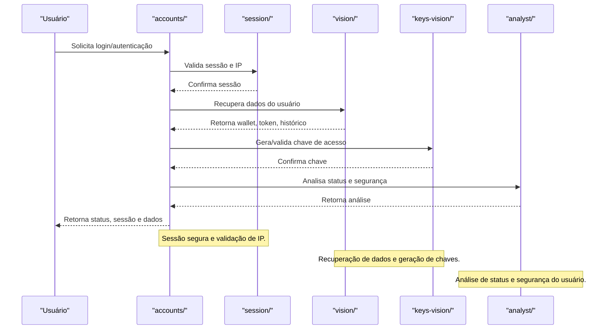

# Módulo accounts/ — Contas Vortexor

## Visão Geral
O módulo `accounts` é responsável por:
- Gerenciar sessões, autenticação, visão do usuário, geração de chaves e análise de status.
- Integrar hooks, wallet, token virtual, histórico de resgate e análise de conteúdo.

### Principais Áreas
- **session/**: encode, redirects, index, IP.
- **vision/**: hooks, wallet, token virtual, autenticação, histórico de resgate, etc.
- **keys-vision/**: geração de chaves.
- **analyst/**: análise de status, modlog, verificação de stats, conteúdo impróprio.

## Fluxo Profissional de Login e Sessão
