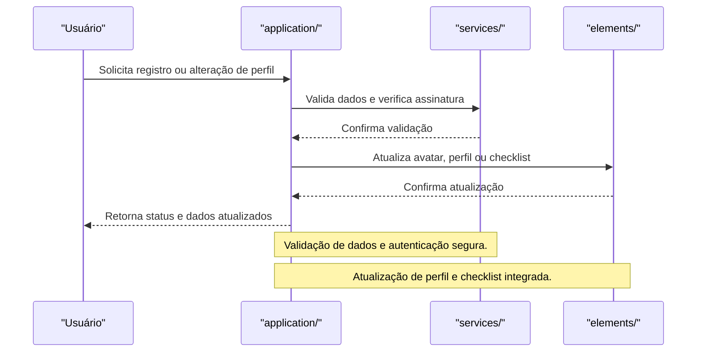

# Módulo application/ — Contas Vortexor

## Visão Geral
O módulo `application` é responsável por:
- Gerenciar informações e conexões de conta do usuário.
- Processar registro, alteração de perfil, checklist e remoção de campos.
- Validar assinaturas e autenticação de usuários.

### Principais Áreas
- **services/**: overview, conexões, informações do usuário, assinatura, verificação, etc.
- **elements/**: alteração de avatar, perfil, checklist, registro e remoção de campos.

## Fluxo Profissional de Registro e Alteração de Perfil

 