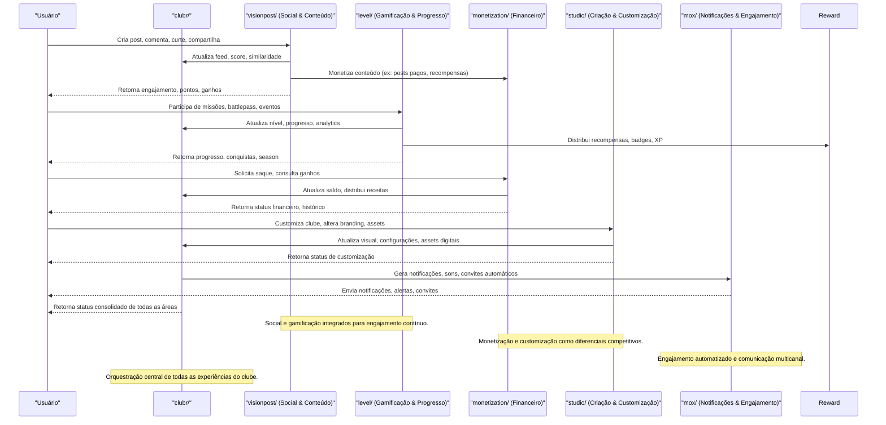

# Módulo clubr/ — Recursos Sociais, Gamificação e Monetização Vortexor

## Visão Geral
O módulo `clubr` é o centro de recursos sociais, gamificação, monetização e customização de clubes no ecossistema Vortexor. Ele integra múltiplos sistemas para criar experiências ricas, engajadoras e economicamente sustentáveis para comunidades e clubes digitais.

### Principais Recursos e Áreas
- **visionpost/**: Interações sociais, posts, sistema de pontuação, similaridade de interesses, monetização de conteúdo, e análise de engajamento.
- **level/**: Sistema de níveis, missões, battlepass, recompensas, seasons, analytics e gerenciamento de atividades do clube.
- **monetization/**: Gestão de receitas, pagamentos, distribuição de ganhos, overview financeiro do clube.
- **studio/**: Ferramentas de criação, customização visual, branding, setup de clubes e assets digitais.
- **mox/**: Notificações, sons, convites, automação de engajamento e comunicação.

## Diagrama Mermaid — Fluxo Ultra Detalhado de Recursos Clubr

## Explicações Ricas dos Recursos
- **Interações Sociais:** Posts, comentários, curtidas, compartilhamentos e análise de similaridade para recomendações e networking.
- **Gamificação:** Missões diárias, semanais, battlepass, conquistas, badges, seasons e analytics de progresso.
- **Monetização:** Ganhos por engajamento, posts pagos, distribuição de receitas, histórico financeiro e solicitações de saque.
- **Customização:** Ferramentas para personalizar o clube, criar assets digitais, alterar branding e configurar experiências exclusivas.
- **Notificações & Engajamento:** Sistema de notificações multicanal, sons customizados, convites automáticos e campanhas de engajamento.
- **Orquestração Central:** O módulo clubr integra e sincroniza todos os recursos, garantindo uma experiência fluida, segura e escalável para comunidades digitais.
 