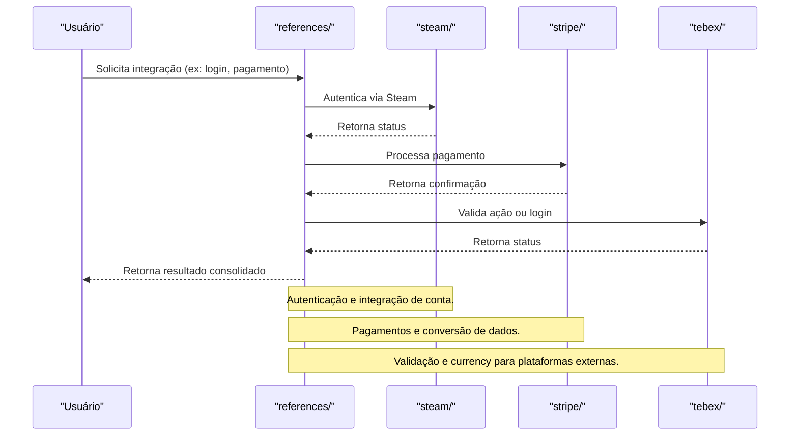

# Módulo references/ — Integrações Externas Vortexor

## Visão Geral
O módulo `references` é responsável por:
- Integrar contas e operações com plataformas externas (Steam, Stripe, Tebex).
- Gerenciar autenticação, pagamentos, conversão de dados e utilidades de integração.

### Principais Áreas
- **steam/**: autenticação, tipos, passport.
- **stripe/**: integração de pagamentos, conversão de datas, utilidades.
- **tebex/**: login, validação, currency, hooks, actions, constantes.

## Fluxo Profissional de Integração Externa

 