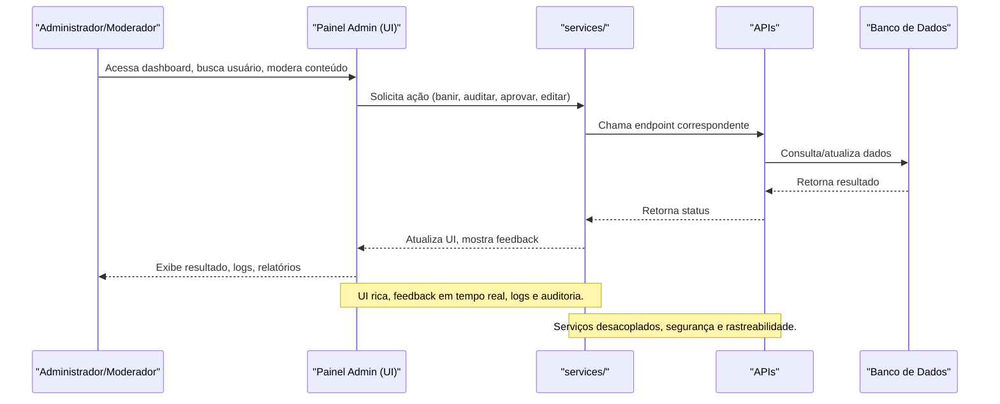

# Administração — Painel e Serviços ClubVision

## Visão Geral
O módulo de administração do ClubVision é responsável por toda a governança, moderação, auditoria, gestão de usuários, conteúdos, permissões, relatórios e insights da plataforma. Ele oferece um painel robusto, seguro e escalável para administradores, moderadores e operadores da plataforma.

### Principais Áreas
- **components/**: Componentes de UI para dashboards, sidebars, headers, gerenciamento de posts, comentários, auditoria, moderação, segurança, carteiras e integrações.
- **services/**: Serviços de gestão, moderação, permissões, geração de códigos, eventos, publicidade, insights e sincronização de permissões.
- **hooks/**: Hooks customizados para integração com APIs administrativas, carteiras e mobile.
- **app/**: Páginas principais do painel, dashboards e fluxos administrativos.
- **lib/**: Utilitários e funções de apoio (ex: cloudinary).
- **types/**: Tipos e contratos para dados administrativos.
- **utils/**: Helpers e utilitários administrativos.

## Diagrama Mermaid — Fluxo de Administração


## Recursos e Funcionalidades
- **Gestão de Usuários:** Busca, banimento, permissões, histórico, roles, auditoria.
- **Moderação de Conteúdo:** Aprovação, rejeição, edição, auditoria de posts, comentários, imagens e vídeos.
- **Segurança:** Logs de acesso, auditoria de ações, relatórios de segurança, sincronização de permissões.
- **Relatórios e Insights:** Estatísticas de uso, eventos, publicidade, histórico de ações, overview de plataforma.
- **Automação:** Geração de códigos, integração com eventos, publicidade, sincronização de permissões e roles.
- **Customização:** Painéis customizáveis, temas, providers, integração com cloudinary e outros serviços.

## Exemplos Práticos
### Exemplo de Banimento de Usuário
```json
{
  "adminId": "admin_001",
  "userId": "user_123",
  "reason": "violação de regras"
}
```
### Resposta
```json
{
  "success": true,
  "status": "banido",
  "timestamp": "2024-06-20T12:00:00Z"
}
```

## Segurança e Compliance
- Todas as ações administrativas são logadas e auditadas.
- Permissões granulares por tipo de admin/moderador.
- Auditoria de conteúdo, histórico de ações e relatórios exportáveis.
- Integração com sistemas antifraude e compliance.

## Redirecionamento para Subdocumentações
- [Componentes de UI](./components.md)
- [Serviços Administrativos](./services.md)
- [Hooks Customizados](./hooks.md)
- [Tipos e Contratos](./types.md)
- [Utilitários e Helpers](./utils.md)
 