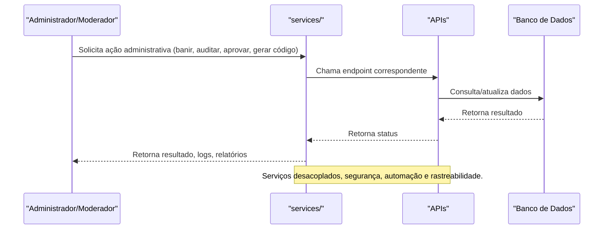

# Arquitetura dos Serviços Administrativos

## Visão Geral
Os serviços administrativos do ClubVision são responsáveis por toda a lógica de negócio, automação, moderação, auditoria, permissões, eventos, publicidade e insights da plataforma. Eles operam de forma desacoplada do frontend, garantindo segurança, rastreabilidade e escalabilidade.

### Principais Responsabilidades
- **Gestão de Usuários:** Banimento, permissões, histórico, roles, auditoria.
- **Moderação:** Aprovação/rejeição de conteúdo, histórico de moderação, logs de ações.
- **Permissões:** Sincronização, atribuição e revogação de permissões administrativas.
- **Eventos e Publicidade:** Gerenciamento de eventos, campanhas, códigos promocionais, publicidade e insights de plataforma.
- **Auditoria e Segurança:** Logs detalhados, geração de relatórios, integração com sistemas antifraude e compliance.
- **Automação:** Geração de códigos, integração com eventos, automação de processos administrativos.

## Diagrama Mermaid — Fluxo de Serviços Administrativos


## Segurança e Compliance
- Todas as ações são logadas e auditadas.
- Permissões granulares e segregação de funções.
- Integração com sistemas antifraude e compliance.
- Auditoria exportável e rastreabilidade total.

## Exemplos Práticos
### Exemplo de Geração de Código Promocional
```json
{
  "adminId": "admin_001",
  "type": "promo",
  "value": 50,
  "expires": "2024-07-01"
}
```
### Resposta
```json
{
  "success": true,
  "code": "PROMO2024",
  "status": "ativo"
}
```

 