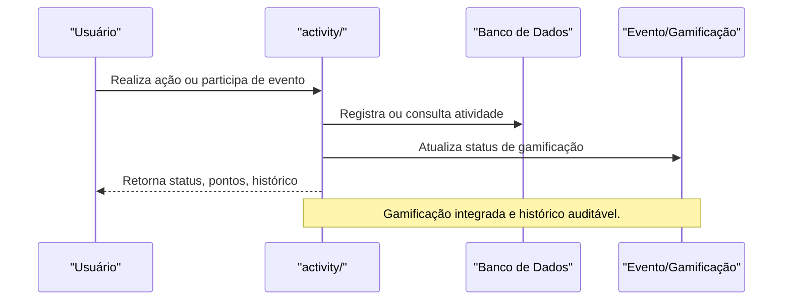

# API activity/ — Atividades e Eventos

## Visão Geral
O domínio `activity` é responsável por:
- Gerenciar atividades, eventos, gamificação e registro de ações dos usuários.
- Processar criação, consulta, atualização e histórico de atividades.

### Principais Endpoints
- Subdiretórios: `postvision/`, `codeims/`, `themes/`.
- Endpoints para registro, consulta e atualização de atividades.

## Diagrama Mermaid — Fluxo de Atividades


## Exemplos Práticos
### Payload de Registro de Atividade
```json
{
  "userId": "abc123",
  "action": "participou_evento",
  "points": 50
}
```
### Resposta de Registro
```json
{
  "success": true,
  "activityId": "act_456",
  "totalPoints": 150
}
```

## Taxas, Limites e Segurança
- Limite de 100 atividades registradas por dia por usuário.
- Todas as ações são autenticadas e auditadas.
- Histórico disponível para admins e usuários.

 