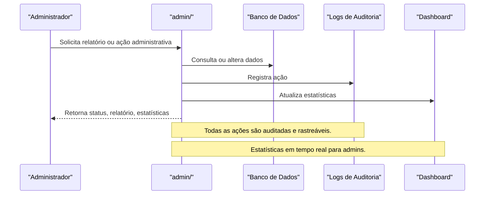

# API admin/ — Painel Administrativo

## Visão Geral
O domínio `admin` é responsável por:
- Gerenciar painel administrativo, auditoria, estatísticas, usuários e conteúdo.
- Processar logs, estatísticas, gerenciamento de usuários, conteúdo e monetização.

### Principais Endpoints
- `audit-logs.ts`, `stats.ts`: Auditoria e estatísticas.
- Subdiretórios: `battlepass/`, `users/`, `dashboard/`, `comments/`, `content/`, `monetization/`, `wallet/`.

## Diagrama Mermaid — Fluxo de Auditoria e Gerenciamento


## Exemplos Práticos
### Payload de Consulta de Estatísticas
```json
{
  "adminId": "admin_001",
  "metric": "usuarios_ativos"
}
```
### Resposta de Estatísticas
```json
{
  "success": true,
  "metric": "usuarios_ativos",
  "value": 1200
}
```

## Taxas, Limites e Segurança
- Apenas admins autenticados podem acessar.
- Todas as ações são logadas e auditadas.
- Limite de 100 requisições por hora por admin.

 