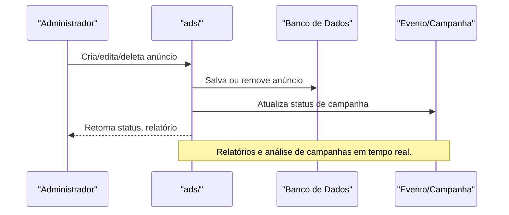

# API ads/ — Anúncios e Campanhas

## Visão Geral
O domínio `ads` é responsável por:
- Gerenciar anúncios, campanhas, eventos e relatórios de publicidade.
- Processar criação, exclusão, consulta e análise de campanhas e anúncios.

### Principais Endpoints
- Endpoints para criar, deletar, consultar e analisar anúncios e campanhas.

## Diagrama Mermaid — Fluxo de Anúncios


## Exemplos Práticos
### Payload de Criação de Anúncio
```json
{
  "adminId": "admin_001",
  "title": "Promoção de Inverno",
  "budget": 1000
}
```
### Resposta de Criação
```json
{
  "success": true,
  "adId": "ad_789",
  "status": "ativo"
}
```

## Taxas, Limites e Segurança
- Limite de 20 anúncios ativos por admin.
- Todas as operações são autenticadas e auditadas.
- Relatórios disponíveis para análise de performance.

 