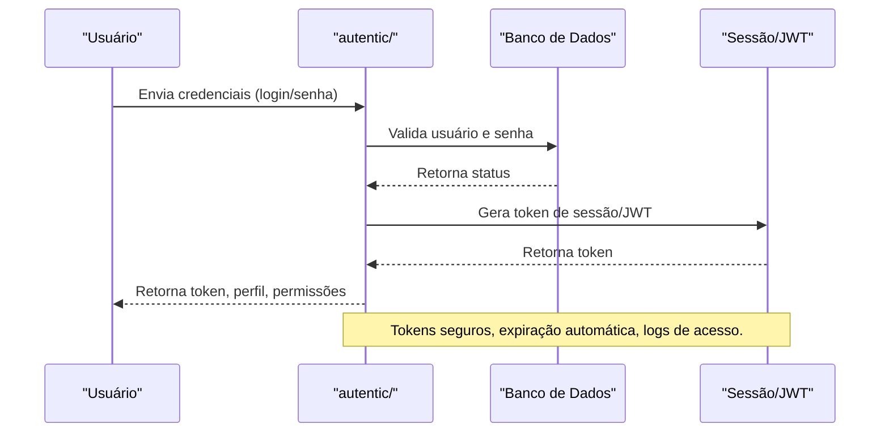

# API autentic/ — Autenticação e Perfis

## Visão Geral
O domínio `autentic` é responsável por:
- Gerenciar autenticação de usuários, perfis, conexões e segurança de acesso.
- Processar login, registro, alteração de perfil, checklist, conexões externas e inventário.

### Principais Endpoints
- `sell.tvl.ts`, `my.tvl.ts`: Operações de tokens virtuais.
- `alterassvatar.ts`, `altprofile.ts`: Alteração de avatar e perfil.
- `application_nvxre.ts`: Registro de aplicação.
- `checklist.ts`, `removeField.ts`: Checklist e remoção de campos.
- `connections_we.ts`, `searchuser.ts`: Conexões e busca de usuários.
- `open.container.ts`: Gerenciamento de inventário.

## Diagrama Mermaid — Fluxo de Autenticação


## Exemplos Práticos
### Payload de Login
```json
{
  "email": "usuario@email.com",
  "password": "senhaSegura123"
}
```
### Resposta de Login
```json
{
  "success": true,
  "token": "jwt_abc123",
  "profile": {
    "username": "usuario123",
    "avatar": "url_avatar.png"
  }
}
```

## Taxas, Limites e Segurança
- Limite de 10 tentativas de login por hora.
- Sessões expiram após 30 minutos de inatividade.
- Dados sensíveis criptografados e logs auditáveis.

 