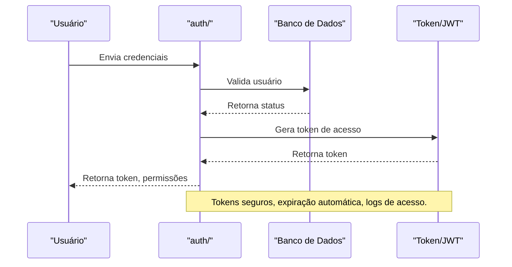

# API auth/ — Fluxos de Autenticação e Permissões

## Visão Geral
O domínio `auth` é responsável por:
- Gerenciar fluxos de autenticação, geração de tokens, permissões e validação de acesso.
- Processar login, geração de tokens, verificação de permissões e logout.

### Principais Endpoints
- Endpoints para login, geração de token, verificação de permissão, logout.

## Diagrama Mermaid — Fluxo de Autenticação


## Exemplos Práticos
### Payload de Login
```json
{
  "email": "usuario@email.com",
  "password": "senhaSegura123"
}
```
### Resposta de Login
```json
{
  "success": true,
  "token": "jwt_abc123",
  "permissions": ["read", "write"]
}
```

## Taxas, Limites e Segurança
- Limite de 10 tentativas de login por hora.
- Tokens expiram após 1 hora de inatividade.
- Todas as operações são autenticadas e auditadas.
 