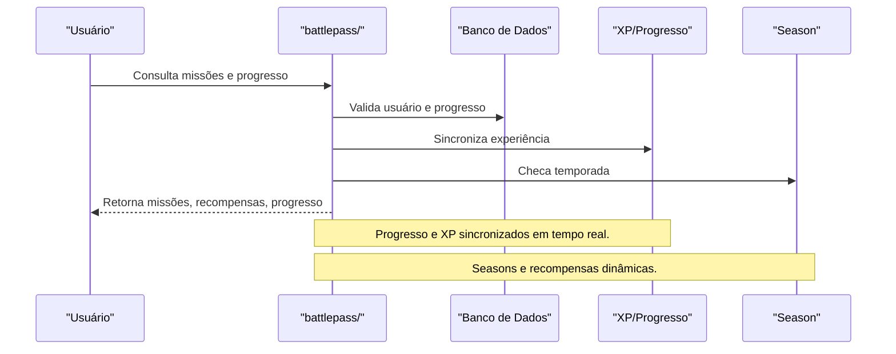

# API battlepass/ — Sistema de Battlepass

## Visão Geral
O domínio `battlepass` é responsável por:
- Gerenciar missões, recompensas, seasons, XP e progresso do usuário.
- Processar sincronização de XP, checagem de season e operações de battlepass.

### Principais Endpoints
- `battlepass.ts`: Lógica principal do battlepass.
- `sync-xp.ts`: Sincronização de experiência.
- `season-check.ts`: Checagem de temporada.

## Diagrama Mermaid — Fluxo de Battlepass


## Exemplos Práticos
### Payload de Consulta de Missões
```json
{
  "userId": "abc123"
}
```
### Resposta de Missões
```json
{
  "success": true,
  "missions": [
    { "id": "m1", "desc": "Ganhe 100 XP", "completed": false }
  ],
  "xp": 1200,
  "season": "2024-Q2"
}
```

## Taxas, Limites e Segurança
- Limite de 50 requisições por hora por usuário.
- Todas as operações são autenticadas e auditadas.
- Progresso salvo automaticamente para evitar perdas.
 