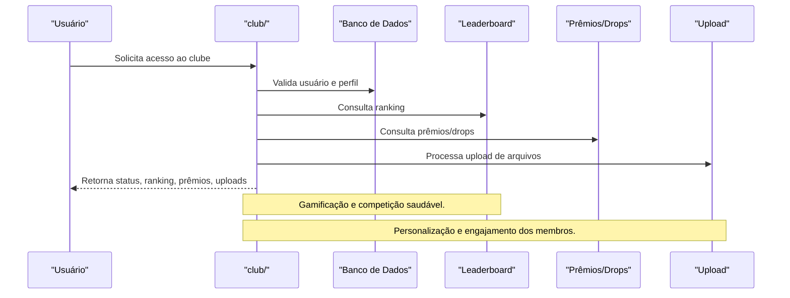

# API club/ — Gestão de Clubes

## Visão Geral
O domínio `club` é responsável por:
- Gerenciar clubes, perfis, rankings, prêmios, conexões, integrações e uploads.
- Processar autenticação, leaderboard, prêmios, uploads, conexões e badges.

### Principais Endpoints
- `verify-id.ts`, `analyst.account.ts`, `visit.profile.ts`: Autenticação e análise de contas.
- `badge.listed.ts`, `club.tvl.ts`, `leaderboard.ts`, `prizes-drops.ts`: Rankings, prêmios, drops.
- `upload.ts`: Upload de arquivos e imagens.
- `logout.ts`, `unlock-account.ts`: Sessão e desbloqueio.
- Subdiretórios: `complements/`, `gaming/`, `connect/`, `follow/`, `address/`.

## Diagrama Mermaid — Fluxo de Gestão de Clube


## Exemplos Práticos
### Payload de Consulta de Ranking
```json
{
  "clubId": "clube_001"
}
```
### Resposta de Ranking
```json
{
  "success": true,
  "ranking": [
    { "user": "user1", "score": 1000 },
    { "user": "user2", "score": 950 }
  ]
}
```

## Taxas, Limites e Segurança
- Limite de 100 requisições por hora por usuário.
- Uploads limitados a 10MB por arquivo.
- Todas as operações são autenticadas e auditadas.
 