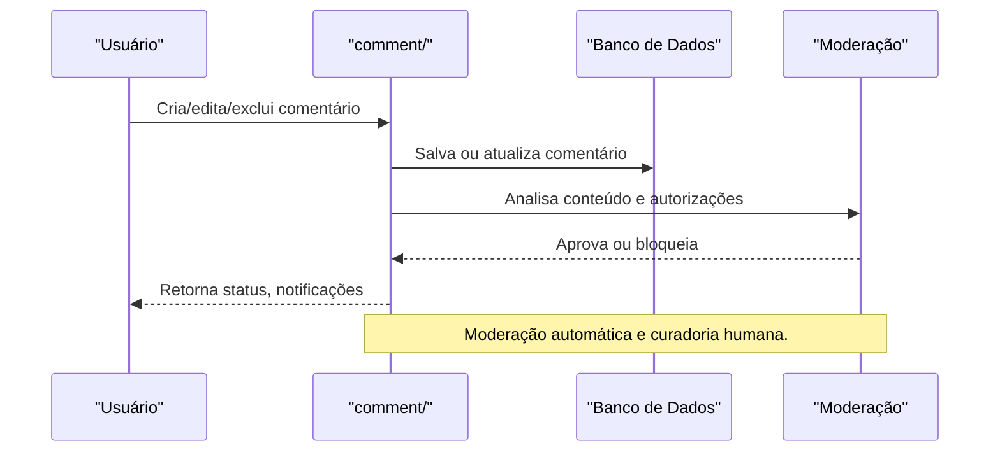

# API comment/ — Comentários e Moderação

## Visão Geral
O domínio `comment` é responsável por:
- Gerenciar comentários, notificações, moderação e interações em posts e conteúdos.
- Processar criação, edição, exclusão e moderação de comentários.

### Principais Endpoints
- Subdiretórios: `postvision/`, `codeims/`, `themes/`.
- `checkcodeauthorization.ts`, `checkuserAutho.ts`, `generateinvite.ts`, `inviteds.ts`, `verifyaccountcode.ts`, `setnickname.ts`: Operações de comentários e autorizações.

## Diagrama Mermaid — Fluxo de Comentários e Moderação


## Exemplos Práticos
### Payload de Comentário
```json
{
  "userId": "abc123",
  "postId": "post_001",
  "content": "Ótimo post!"
}
```
### Resposta de Comentário
```json
{
  "success": true,
  "commentId": "cmt_789",
  "status": "aprovado"
}
```

## Taxas, Limites e Segurança
- Limite de 50 comentários por dia por usuário.
- Moderação automática e denúncias disponíveis.
- Logs de todas as interações para auditoria.
 