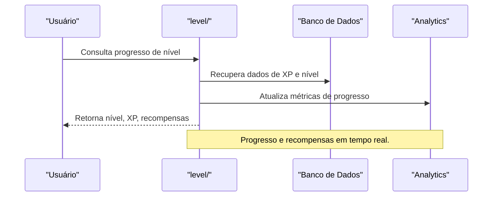

# API level/ — Sistema de Níveis e Progressão

## Visão Geral
O domínio `level` é responsável por:
- Gerenciar níveis, XP, progressão, analytics e recompensas dos usuários.
- Processar atualizações de nível, consulta de progresso e distribuição de recompensas.

### Principais Endpoints
- `level.nvrp.ts`: Lógica principal de níveis e XP.

## Diagrama Mermaid — Fluxo de Progressão de Nível


## Exemplos Práticos
### Payload de Consulta de Nível
```json
{
  "userId": "abc123"
}
```
### Resposta de Nível
```json
{
  "success": true,
  "level": 12,
  "xp": 3400,
  "nextLevel": 13,
  "xpToNext": 600
}
```

## Taxas, Limites e Segurança
- Limite de 30 consultas por hora por usuário.
- Todas as operações são autenticadas e auditadas.
- Analytics de progresso para admins e usuários.

 