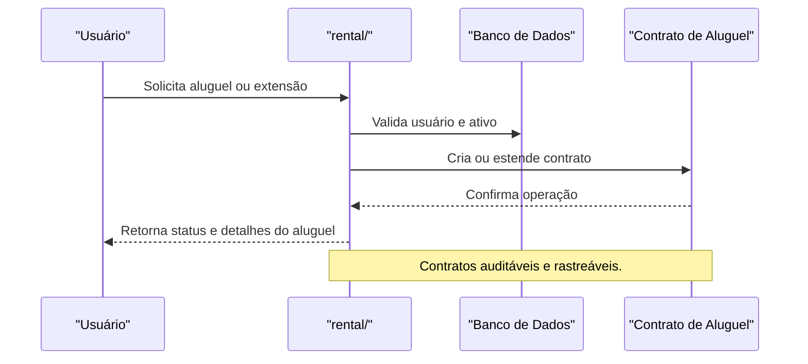

# API rental/ — Aluguel de Ativos

## Visão Geral
O domínio `rental` é responsável por:
- Gerenciar aluguel de ativos digitais, contratos e histórico de locações.
- Processar extensão de aluguel, consulta de contratos e histórico de uso.

### Principais Endpoints
- `extend-rental.ts`: Extensão de aluguel.
- `get-rentals.ts`: Consulta de contratos e histórico.

## Diagrama Mermaid — Fluxo de Aluguel


## Exemplos Práticos
### Payload de Extensão de Aluguel
```json
{
  "userId": "abc123",
  "assetId": "asset_001",
  "days": 7
}
```
### Resposta de Extensão
```json
{
  "success": true,
  "contractId": "contrato_789",
  "newEndDate": "2024-07-01"
}
```

## Taxas, Limites e Segurança
- Limite de 3 extensões por ativo por mês.
- Contratos possuem logs de auditoria e histórico de alterações.
- Todas as operações são autenticadas e auditadas.
 