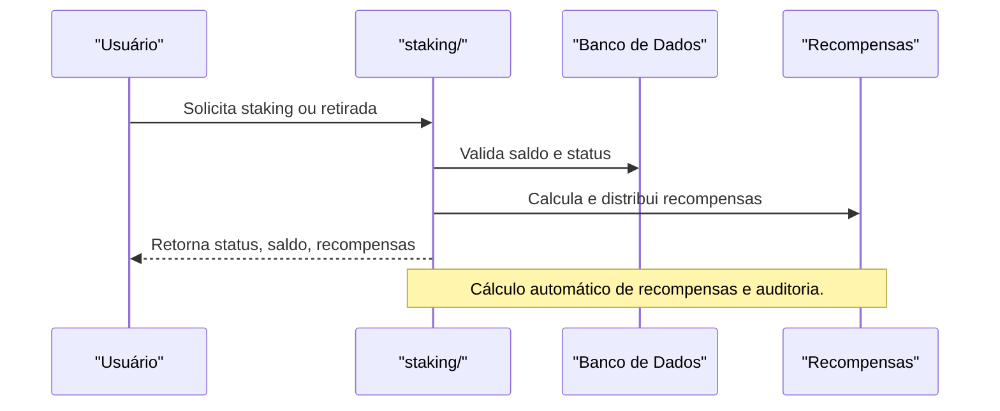

# API staking/ — Staking de Ativos Digitais

## Visão Geral
O domínio `staking` é responsável por:
- Gerenciar operações de staking, delegação, recompensas e consulta de status.
- Processar cálculos de recompensas, delegação e retirada de staking.

### Principais Endpoints
- `calculate.ts`, `reward.ts`, `finalize.ts`, `delegate.ts`: Operações de staking e recompensas.

## Diagrama Mermaid — Fluxo de Staking


## Exemplos Práticos
### Payload de Staking
```json
{
  "userId": "abc123",
  "amount": 1000
}
```
### Resposta de Staking
```json
{
  "success": true,
  "staked": 1000,
  "reward": 15
}
```

## Taxas, Limites e Segurança
- Taxa de 0,2% por operação de staking.
- Limite de 5 operações por dia por usuário.
- Todas as operações são autenticadas e auditadas.
 