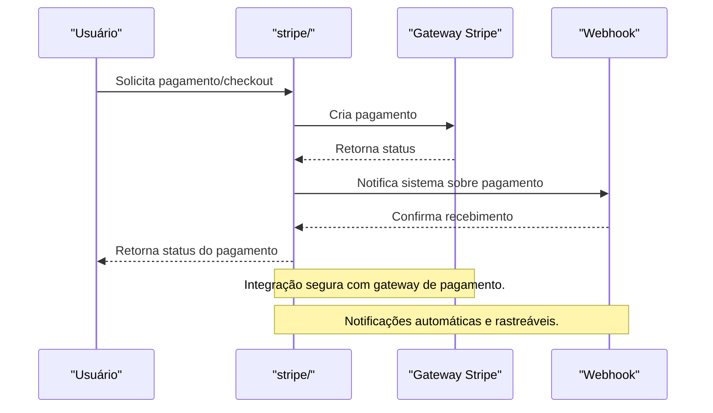

# API stripe/ — Pagamentos e Checkout

## Visão Geral
O domínio `stripe` é responsável por:
- Gerenciar pagamentos, webhooks, checkout, produtos e clientes.
- Processar criação de pagamentos, consulta de produtos, clientes e webhooks.

### Principais Endpoints
- Subdiretórios: `webhooks/`, `products/`, `customers/`, `checkout/`, `prices/`.
- Endpoints para criar pagamento, consultar produtos, clientes e preços.

## Diagrama Mermaid — Fluxo de Pagamento Stripe


## Exemplos Práticos
### Payload de Pagamento
```json
{
  "userId": "abc123",
  "amount": 49.90,
  "currency": "BRL"
}
```
### Resposta de Pagamento
```json
{
  "success": true,
  "paymentId": "pay_456",
  "status": "paid"
}
```

## Taxas, Limites e Segurança
- Taxa Stripe padrão (ex: 2,9% + R$0,50 por transação).
- Limite de 10 pagamentos por hora por usuário.
- Todas as operações são autenticadas, auditadas e notificadas via webhook.

 