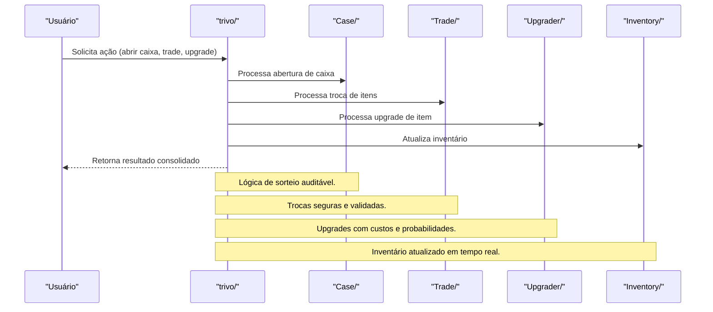

# API trivo/ — Operações de Mercado e Gamificação

## Visão Geral
O domínio `trivo` é responsável por:
- Gerenciar operações de mercado, cases, trading, upgrades e inventário.
- Processar abertura de caixas, trocas, upgrades e consulta de inventário.

### Principais Endpoints
- Subdiretórios: `upgrader/`, `checkout/`, `trading/`, `trade/`, `case/`.
- Endpoints para abrir caixa, realizar trade, upgrade e consultar inventário.

## Diagrama Mermaid — Fluxo de Operações Trivo


## Exemplos Práticos
### Payload de Abertura de Caixa
```json
{
  "userId": "abc123",
  "caseId": "case_gold_01"
}
```
### Resposta de Abertura
```json
{
  "success": true,
  "prize": {
    "itemId": "item_legendary_sword",
    "rarity": "legendary"
  },
  "newBalance": 90
}
```

## Taxas, Limites e Segurança
- Taxa variável por operação (conforme tipo de caixa/trade/upgrade).
- Limite de 20 operações por dia por usuário.
- Todas as operações são autenticadas, auditadas e rastreáveis.

 