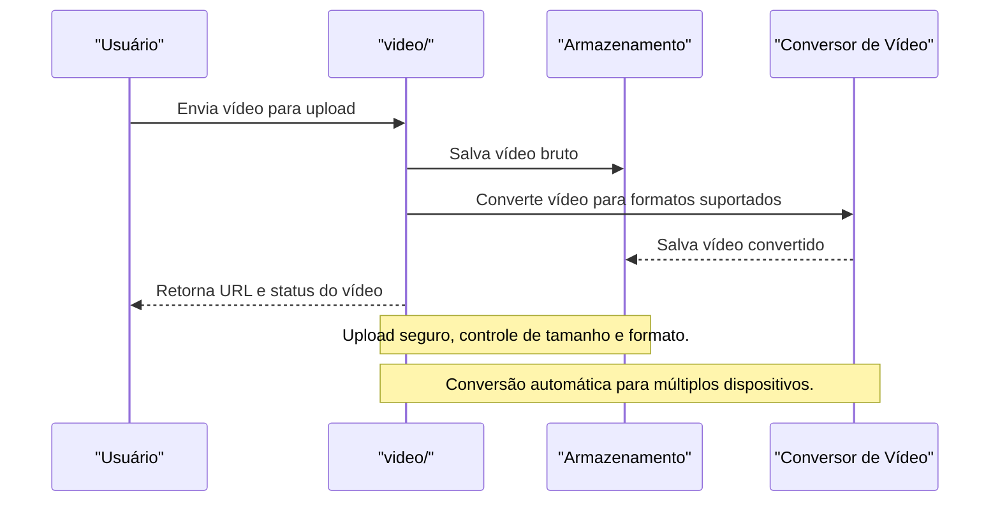

# API video/ — Upload e Streaming de Vídeos

## Visão Geral
O domínio `video` é responsável por:
- Gerenciar upload, streaming, manipulação e controle de vídeos dos usuários.
- Processar uploads, conversão, listagem e controle de acesso a vídeos.

### Principais Endpoints
- `videoX/`, `videos/`: Upload, listagem e manipulação de vídeos.

## Diagrama Mermaid — Fluxo de Upload e Streaming


## Exemplos Práticos
### Payload de Upload
```json
{
  "userId": "abc123",
  "file": "video.mp4"
}
```
### Resposta de Upload
```json
{
  "success": true,
  "videoUrl": "https://cdn.novision.app/videos/abc123.mp4"
}
```

## Taxas, Limites e Segurança
- Limite de 5 uploads por hora por usuário.
- Tamanho máximo de 100MB por vídeo.
- Vídeos passam por moderação automática e logs de acesso.

 