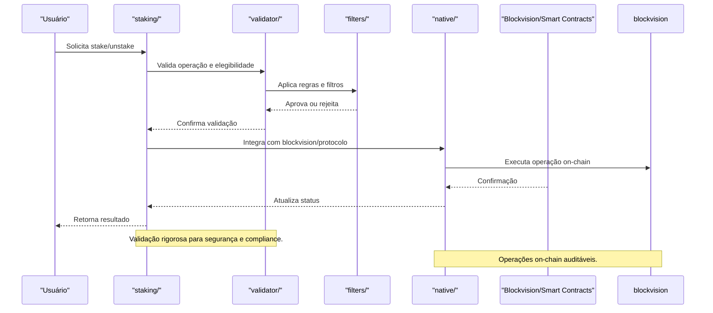

O módulo `staking` é responsável por:
- Gerenciar mecanismos de staking de ativos digitais.
- Validar operações e garantir segurança das participações.
- Aplicar filtros e regras para elegibilidade.
- Integrar soluções nativas e customizadas de staking.

- **Taxas de Staking:**
  - Pode haver uma taxa de entrada (ex: 0,2%) para iniciar o staking, destinada à manutenção da rede.
  - Taxa de performance sobre recompensas (ex: 5% do yield gerado).
- **Custos de Retirada:**
  - Retiradas antecipadas podem incidir penalidades ou taxas extras (ex: 1% do valor).
- **Pontos de Participação:**
  - Usuários acumulam pontos de participação a cada ciclo de staking bem-sucedido.
  - Pontos podem ser usados para aumentar o APY, acessar pools VIP ou participar de votações.
- **Transparência:**
  - Todas as taxas e penalidades são informadas antes da confirmação.
  - Relatórios de ganhos, custos e pontos disponíveis para consulta.
