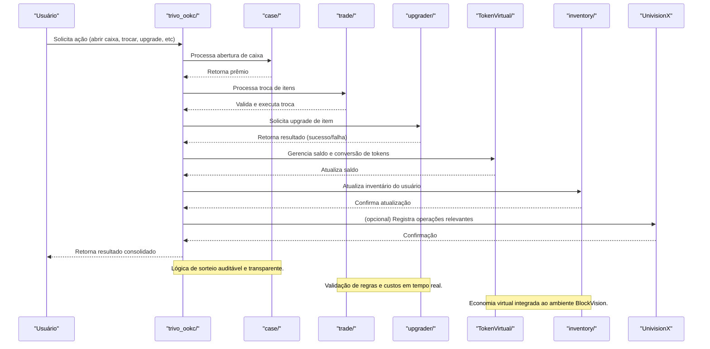

O módulo `trivo_ookc` é responsável por:
- Gerenciar operações de cases (caixas), trocas (trade), upgrades de ativos, tokens virtuais e inventário de usuários.
- Integrar lógica de gamificação, economia de itens e operações de mercado virtual.

### Principais Áreas
- **case/**: Abertura de caixas, distribuição de prêmios, lógica de sorteio.
- **trade/**: Troca de itens entre usuários, negociação e validação de ofertas.
- **upgrader/**: Sistema de upgrade de itens, probabilidades e custos.
- **TokenVirtual/**: Gerenciamento de tokens virtuais, obtenção e conversão (ex: MyTvl.GetX.ts).
- **inventory/**: Controle e exibição do inventário de cada usuário (ex: OpenContainer.ts).

## Fluxo Profissional de Operações Trivo

## Custos, Taxas e Pontos

- **Taxas de Abertura de Caixa:**
  - Cada abertura de caixa pode ter um custo em tokens virtuais (TVL) ou moeda da plataforma.
  - Taxas variáveis conforme raridade e tipo de caixa.
- **Taxas de Trade:**
  - Trocas entre usuários podem incidir uma taxa percentual (ex: 1% do valor do item) ou taxa fixa.
- **Custos de Upgrade:**
  - Upgrades de itens exigem pagamento em tokens virtuais e/ou pontos, além de possíveis taxas de falha.
- **Pontos de Atividade:**
  - Usuários acumulam pontos ao abrir caixas, realizar trades ou upgrades.
  - Pontos podem ser trocados por benefícios, descontos ou acesso a caixas exclusivas.
- **Transparência:**
  - Todas as taxas e custos são exibidos antes da confirmação.
  - Relatórios de operações, custos e pontos disponíveis para consulta.

