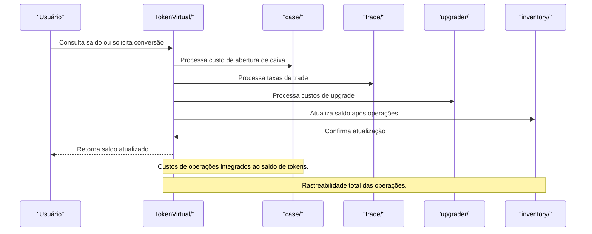

O módulo `TokenVirtual` é responsável por:
- Gerenciar saldo, emissão, conversão e uso de tokens virtuais (TVL).
- Integrar tokens a operações de cases, trades, upgrades e inventário.
- Garantir segurança, rastreabilidade e transparência nas operações.
- Todas as operações de débito/crédito são registradas e auditáveis.
- Conversão de pontos em tokens e vice-versa.
- Integração direta com módulos de case, trade, upgrader e inventário.

