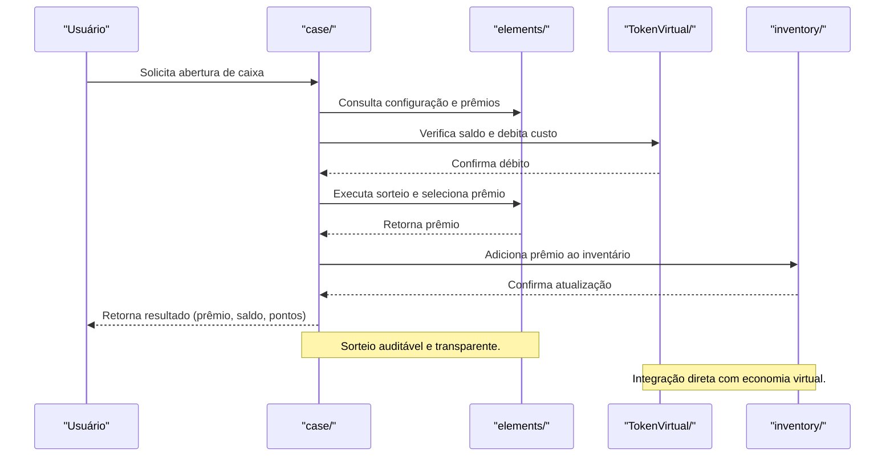

# Arquitetura — trivo_ookc/case

## Visão Geral
O módulo `case` é responsável por:
- Gerenciar a lógica de abertura de caixas (cases), sorteio de prêmios e distribuição de recompensas.
- Garantir transparência, auditabilidade e segurança nos sorteios.
- Integrar com inventário, tokens virtuais e sistema de pontos.

### Principais Áreas
- **src/**: Implementação da lógica de sorteio, regras de distribuição e validação de prêmios.
- **elements/**: Definição dos tipos de caixas, raridades, probabilidades e recompensas possíveis.

## Arquitetura Interna
- Sorteios utilizam algoritmos pseudoaleatórios auditáveis.
- Cada caixa possui configuração de raridade, custo e tabela de prêmios.
- Integração direta com inventário do usuário e saldo de tokens virtuais.
- Logs de operações para auditoria e prevenção de fraudes.

## Fluxo Profissional de Abertura de Caixa

 