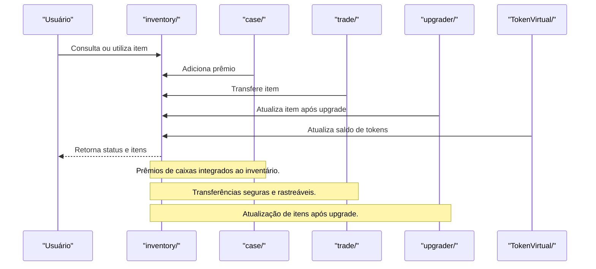

# Arquitetura — trivo_ookc/inventory

## Visão Geral
O módulo `inventory` é responsável por:
- Gerenciar o inventário de itens de cada usuário.
- Integrar operações de recebimento de prêmios, trocas, upgrades e uso de tokens virtuais.
- Garantir consistência, rastreabilidade e segurança dos ativos digitais.

### Principais Arquivos
- **OpenContainer.ts**: Lógica de atualização, consulta e exibição do inventário.

## Arquitetura Interna
- Todas as operações de adição, remoção e atualização de itens são registradas.
- Integração direta com módulos de case, trade, upgrader e TokenVirtual.
- Logs detalhados para auditoria e recuperação de ativos.

## Fluxo Profissional de Inventário

 