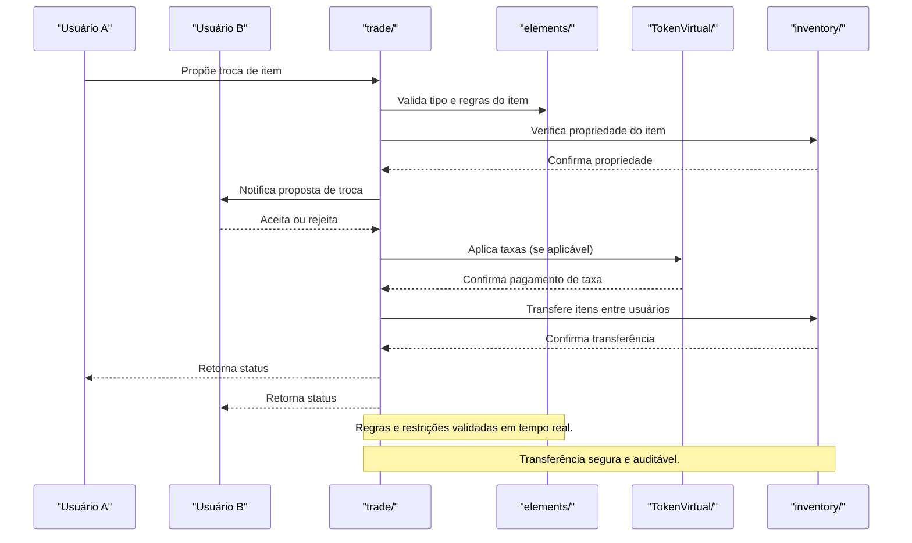

# Arquitetura — trivo_ookc/trade

## Visão Geral
O módulo `trade` é responsável por:
- Gerenciar trocas de itens entre usuários.
- Validar ofertas, regras de negociação e taxas aplicáveis.
- Garantir segurança, transparência e registro de todas as operações.

### Principais Áreas
- **src/**: Implementação da lógica de negociação, validação de ofertas e execução de trocas.
- **elements/**: Definição dos tipos de itens negociáveis, restrições e taxas.

## Arquitetura Interna
- Todas as trocas passam por validação de saldo, propriedade e regras de restrição.
- Taxas podem ser aplicadas conforme tipo de item ou perfil do usuário.
- Logs detalhados para auditoria e resolução de disputas.

## Fluxo Profissional de Trade

 