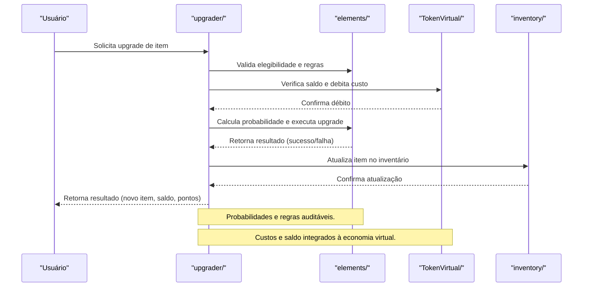

# Arquitetura — trivo_ookc/upgrader

## Visão Geral
O módulo `upgrader` é responsável por:
- Gerenciar upgrades de itens, aplicando probabilidades de sucesso e custos.
- Integrar economia de tokens virtuais e pontos de atividade.
- Garantir transparência e registro de todas as tentativas de upgrade.

### Principais Áreas
- **src/**: Implementação da lógica de upgrade, cálculo de probabilidades e custos.
- **elements/**: Definição dos itens elegíveis, regras de upgrade e tabelas de sucesso/falha.

## Arquitetura Interna
- Upgrades exigem pagamento em tokens virtuais e/ou pontos.
- Probabilidade de sucesso pode variar conforme item, nível e perfil do usuário.
- Todas as tentativas são registradas para auditoria e estatísticas.

## Fluxo Profissional de Upgrade

 