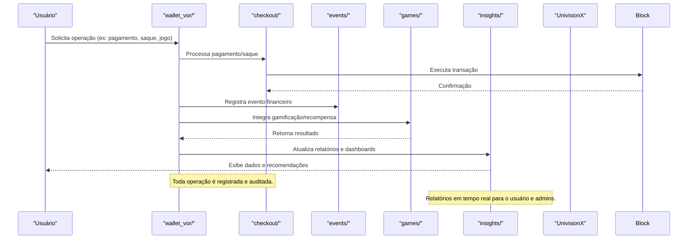

O módulo `wallet_vor` é responsável por:
- Gerenciar carteiras digitais dos usuários.
- Processar pagamentos, transações e eventos financeiros.
- Integrar jogos e sistemas de recompensas.
- Gerar insights e relatórios de uso.

- **Taxas de Transação:**
  - Cada operação de pagamento, saque ou transferência pode incidir uma taxa percentual (ex: 0,5% a 2%) sobre o valor movimentado, variável conforme o tipo de operação e o perfil do usuário.
  - Taxas dinâmicas para jogos e recompensas, podendo ser reduzidas para usuários VIP ou em campanhas promocionais.
- **Custos de Saque:**
  - Saques para carteiras externas ou exchanges podem ter uma taxa fixa (ex: 2 NVX) ou percentual, além de eventuais custos de rede blockchain.
- **Pontos e Recompensas:**
  - Usuários acumulam pontos a cada transação, participação em jogos ou eventos.
  - Pontos podem ser trocados por benefícios, descontos em taxas, TVLs(Tokens Virtual Listed) ou acesso a funcionalidades exclusivas.
- **Transparência:**
  - Todas as taxas e custos são exibidos antes da confirmação da operação.
  - Relatórios de custos e pontos disponíveis em insights/ para acompanhamento detalhado.
