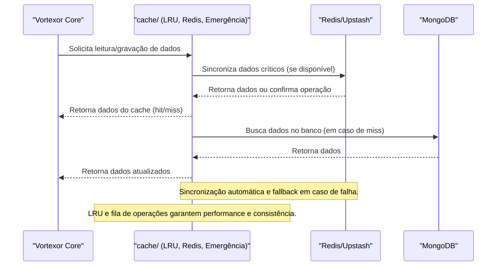

O módulo `cache` é responsável por:
- Gerenciar múltiplas estratégias de cache (memória, Redis, fallback de emergência).
- Implementar LRU, versionamento, fila de operações e sincronização com Redis.
- Garantir alta disponibilidade e performance mesmo em cenários de falha.

- LRU com versionamento e métricas.
- Fila de operações com prioridade.
- Fallback automático para cache de emergência.

