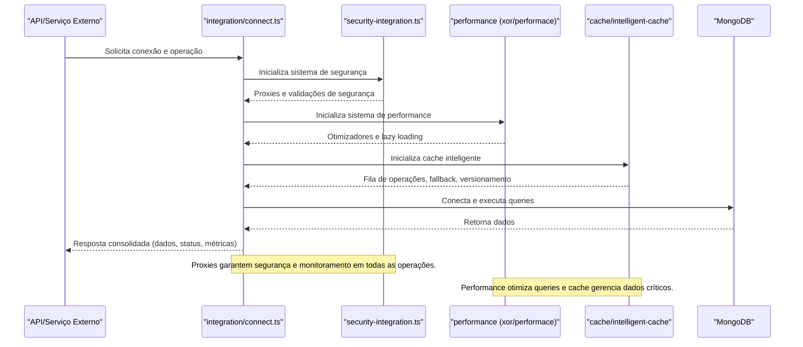

O módulo `integration` é responsável por:
- Gerenciar conexões com bancos de dados (MongoDB), cache e sistemas externos.
- Orquestrar a inicialização de todos os subsistemas do core (segurança, performance, cache, etc).
- Definir estratégias de invalidação de cache e fallback.
- Detectar ambiente (produção/desenvolvimento) e ajustar parâmetros dinamicamente.

- Singleton para conexões e sistemas.
- Fila de operações para cache.
- Fallback automático em caso de falha.
- Configuração inteligente por ambiente.
