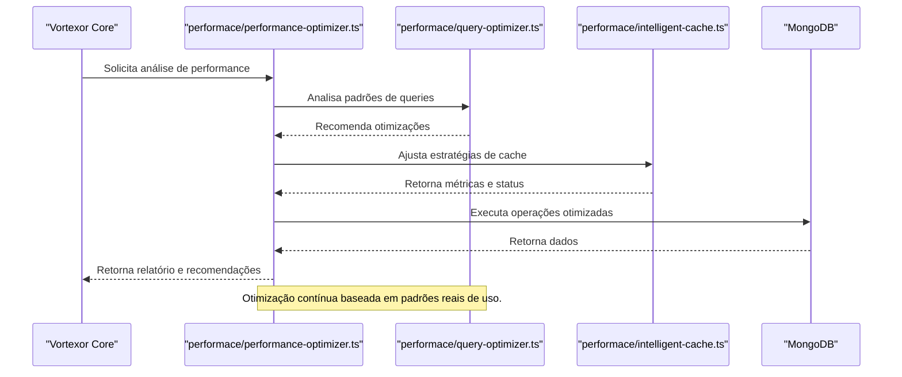

O módulo `performance` é responsável por:
- Otimização de queries e operações de banco de dados.
- Implementação de cache inteligente (IntelligentCacheSystem).
- Monitoramento e recomendações automáticas de performance.

- Diagnóstico e recomendações automáticas.
- Fila de operações e versionamento de cache.
- Worker pool para operações intensivas.
