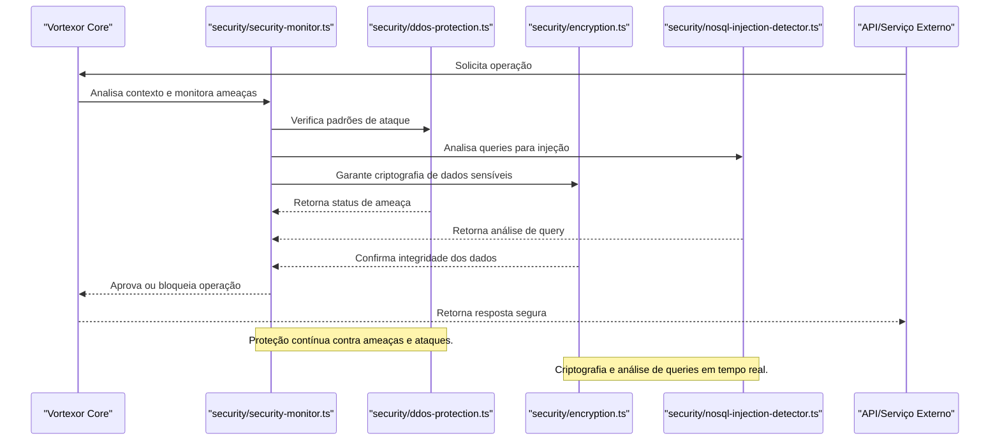

O módulo `security` é responsável por:
- Monitoramento e proteção contra ameaças (DDoS, injeção, ataques comportamentais).
- Criptografia avançada de dados sensíveis.
- Detecção e bloqueio de operações suspeitas.

- Monitoramento em tempo real e alertas automáticos.
- Criptografia AES-256-GCM.
- Detecção adaptativa de ameaças.
