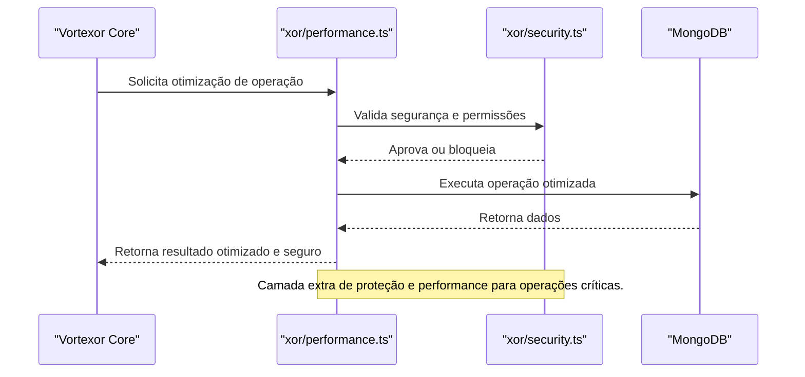

O módulo `xor` é responsável por funcionalidades avançadas de performance e segurança, atuando como camada de otimização e proteção adicional para operações críticas. 

- Lazy loading de componentes.
- Otimização baseada em uso de recursos.
- Proteção adicional para operações sensíveis.
