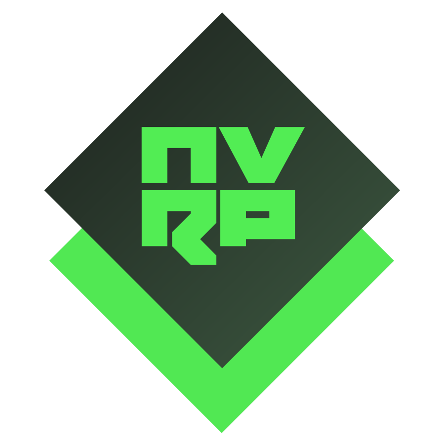
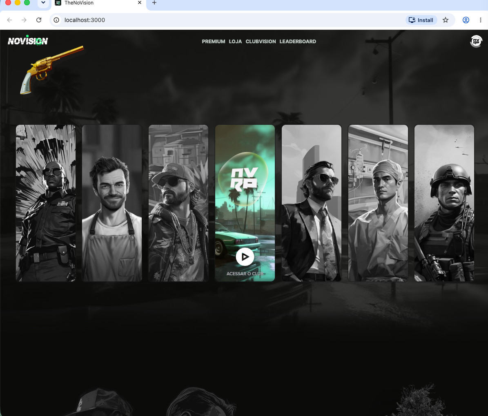

<p align="right">
  
</p>

# ClubVision

Plataforma completa para comunidades e clubes no ecossistema Novision — site, bot de Discord e painel administrativo em um único projeto.



## Sobre o Projeto

O ClubVision é uma plataforma desenvolvida para a comunidade Novision, destinada ao público de língua portuguesa. Seu objetivo é fornecer uma infraestrutura robusta, modular e escalável para clubes, comunidades e organizações no ambiente digital — integrando gamificação, economia digital, automação, interatividade social, marketplace e muito mais.

> **Nota sobre o código:** este projeto foi criado em 2023 para estudo e aprendizagem em programação. Todo o código foi escrito à mão, antes da era das IAs agenticas. Por isso, o código pode apresentar escritas confusas, poluições e complexidades excessivas — o projeto foi pensado justamente para desenvolvimento e aprendizagem em programação na época.

## Recursos

### Plataforma Web (Next.js)
- **Perfis de usuários** com progressão, níveis, XP e conquistas
- **Clubes e comunidades**: criação, gestão, rankings e prêmios
- **Loja e marketplace**: cases, inventário, trade e upgrades de itens
- **Battle pass**: missões, recompensas e temporadas
- **Leaderboard** e estatísticas da comunidade
- **Pagamentos**: checkout e integração com Stripe e Tebex
- **Carteira digital (wallet)** com histórico de transações
- **Vídeos e conteúdo**: upload e streaming integrados
- **Artigos e central de ajuda** com suporte a MDX

### Bot de Discord
- Comandos de moderação, utilidade e diversão
- Sistema de economia e recompensas da comunidade
- Giveaways, música (Lavalink) e atividades em grupo
- Logs de eventos, entradas e saídas de membros
- Integração direta com as contas e o inventário da plataforma

### Painel Administrativo
- Dashboard com métricas e insights da plataforma
- Gestão de usuários, conteúdo, posts e comentários
- Auditoria, moderação e controle de permissões
- Gestão de carteiras, publicidade e eventos

### Infraestrutura (core)
- Cache inteligente com Redis/Upstash (LRU, TTL dinâmico, cache warming)
- Segurança: proteção contra DDoS, criptografia e detecção de injeções
- Monitoramento: métricas, health checks e relatórios
- Otimização de performance e de queries

## Tecnologias

- **Frontend/API**: Next.js, React, TypeScript, Tailwind CSS, Chakra UI, MUI
- **Bot**: Node.js, discord.js
- **Banco de dados**: MongoDB (Mongoose)
- **Cache**: Redis / Upstash
- **Pagamentos**: Stripe, Tebex
- **Mídia**: Cloudinary

## Como executar

```bash
# Instalar dependências
npm install

# Configurar variáveis de ambiente
cp .env.example .env   # preencha com suas credenciais

# Rodar a plataforma web em desenvolvimento
npm run dev

# Rodar o bot de Discord
npm run bot
```

## Documentação

Toda a documentação de arquitetura, fluxos, diagramas e detalhes técnicos está organizada na pasta [`.project`](./.project):

- [`accounts`](./.project/accounts) — contas, sessões, perfis e integrações externas
- [`admin`](./.project/admin) — painel administrativo e serviços de governança
- [`api`](./.project/api) — domínios de API (clubes, pagamentos, staking, gamificação etc.)
- [`blockvision`](./.project/blockvision) — carteiras, staking e economia digital
- [`core`](./.project/core) — cache, segurança, performance e monitoramento

## Licença

Distribuído sob a licença **MIT**. Consulte o arquivo [license.md](./license.md).
